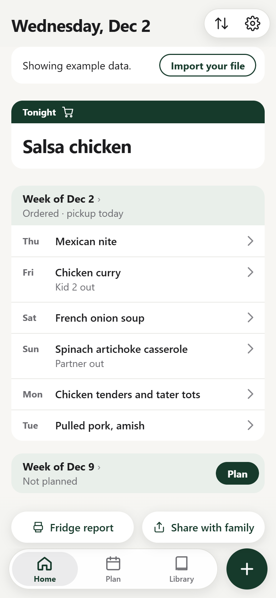
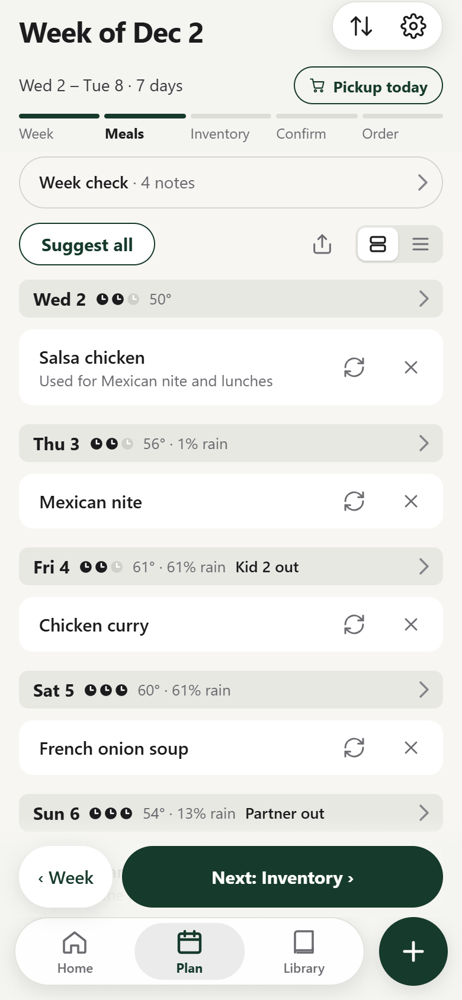
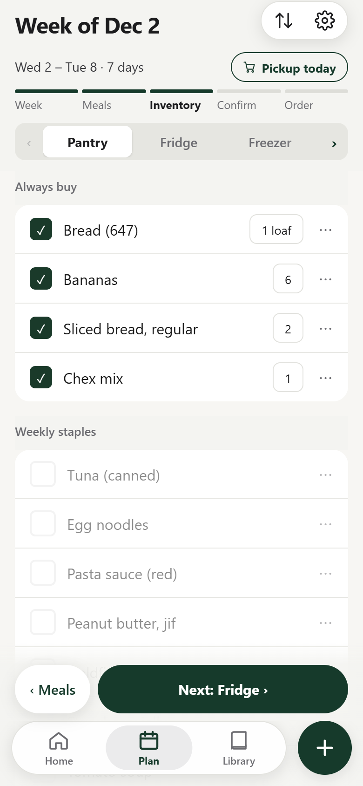
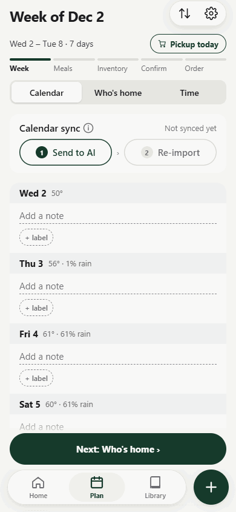

# Grocery Planner

Plan a week of family dinners, check what's in the cupboards, and turn it into a grocery pickup order — on your phone, with no account and no server.

<p align="center">  </p>

**Try it:** open **https://jamesgulick.github.io/grocery-planner-app/** on your phone and tap **Start with example data**. Everything you do stays in your own browser.

---

## Who it's for

- A household that plans dinners a week at a time and orders groceries for pickup.
- People who want the app to **cross-check** the week (who's home, who won't eat what, what's already in the fridge) while they make the decisions.
- Tinkerers comfortable forking a repo, if you want to make it yours.

It's a personal project, built for one family and shared as is. It isn't a hosted service, and there's no support promise.

## How a week goes

<p align="center"></p>

1. **Week** — note what's on each day, who's home, and how much time there is to cook.
2. **Meals** — suggest the whole week or one day at a time, swap anything, and add your own. Each night is a main plus sides; the planner makes sure everyone home has something they'll eat, counting leftovers.
3. **Inventory** — walk each storage place and tick what you need. Staples and anything a planned meal calls for come up on their own.
4. **Confirm** — the whole order in one list: amounts, items shared across meals, last-minute additions.
5. **Order** — the list in batches, ready to paste or share into whatever builds your cart.

Afterwards, **Home** shows tonight and the rest of the week, and asks you to rate meals you've just tried so suggestions get better.

More detail, with screenshots: [docs/planning-week.md](docs/planning-week.md).

## Your data

- Everything lives in your browser's local storage. There's no backend, no account, no tracking.
- **Back up** saves the whole thing as one file, `grocery_db.json`. **Import** loads a file, and shows you every change before anything loads.
- Moving between phone and laptop is a file you carry over (iCloud Drive, a shared folder, anything).
- The file format: [docs/data-file.md](docs/data-file.md).

## How suggestions work

Suggestions come from a small, deterministic engine (`src/engine/composeWeek.js`), not random picks. It composes the week under a fixed order of priorities:

1. **Everyone eats.** Each person home that night has something they'll eat, counting leftovers. "Won't eat" is a fact the planner works around — a side that can be their dinner, or leftovers — not a ban.
2. **Spacing.** Similar meals (same kind of dish, back-to-back takeout) aren't bunched together.
3. **Freshness.** Meals come back on their own rhythm — weekly, every two weeks, or occasionally.
4. **Small leans.** Effort against the time you have, the weather forecast, and what people like.

Randomness only breaks ties. The planner suggests; you decide. It never blocks or silently changes what you put on a day, and a **Week check** tells you what it noticed.

## Make it yours

Fork the repo, turn on GitHub Pages, and set your household, location and storage places. Step by step: [docs/setup.md](docs/setup.md).

## Optional: AI helpers

The app can hand its data file to an AI chat of your choice and take it back: to fill in each day's notes from your calendar, to add a recipe from a link, or to fill in missing details on your meals. You see every change before it loads. None of this is required. How it works: [docs/ai-round-trips.md](docs/ai-round-trips.md).

## Develop

Requires Node.js 18+.

```bash
npm install
npm run dev     # http://localhost:5173
npm run check   # lint + production build
```

`src/grocery-app.jsx` is the app's root; screens live in `src/home`, `src/plan`, `src/library` and `src/shell`; the engine lives in `src/engine`. Pushing to `main` deploys to GitHub Pages through `.github/workflows/deploy.yml`.

## Contributing

Issues and ideas are welcome. Pull requests may not be merged — see [CONTRIBUTING.md](CONTRIBUTING.md).

## License

[MIT](LICENSE)
