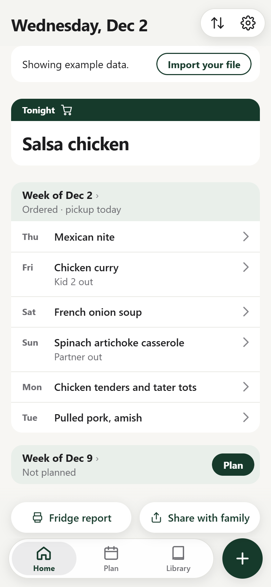
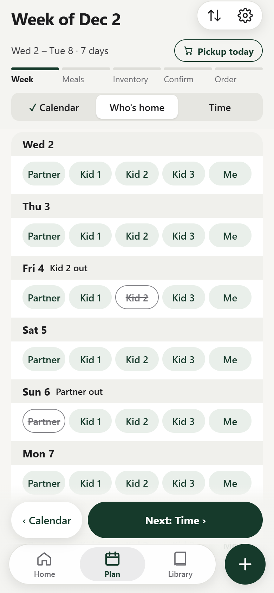
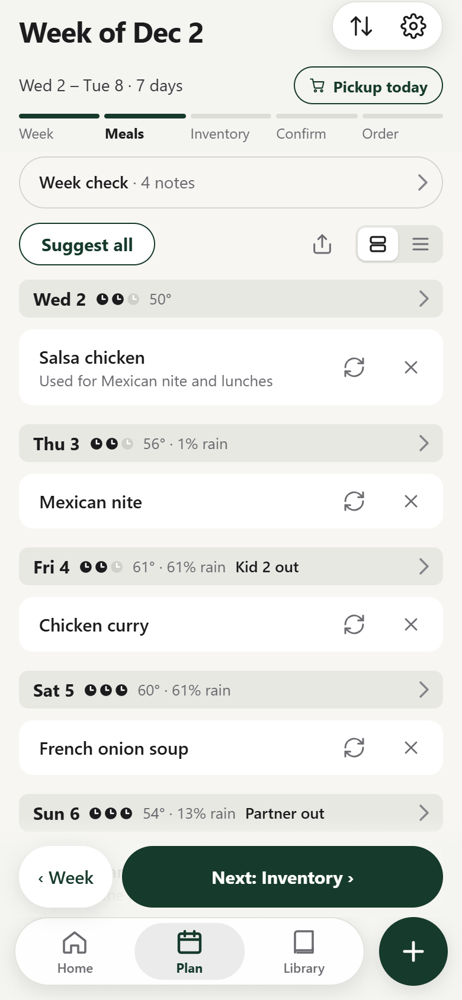
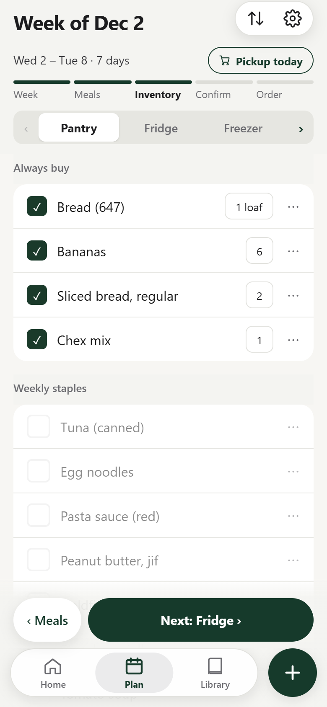
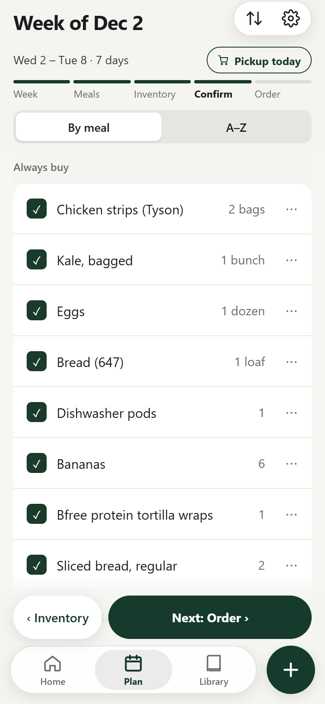
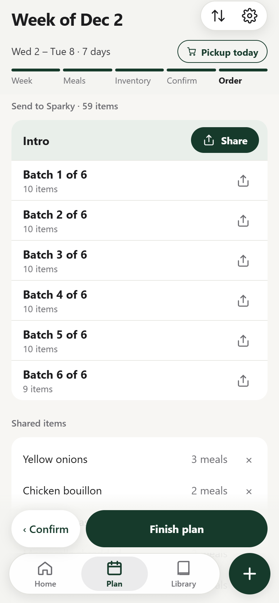
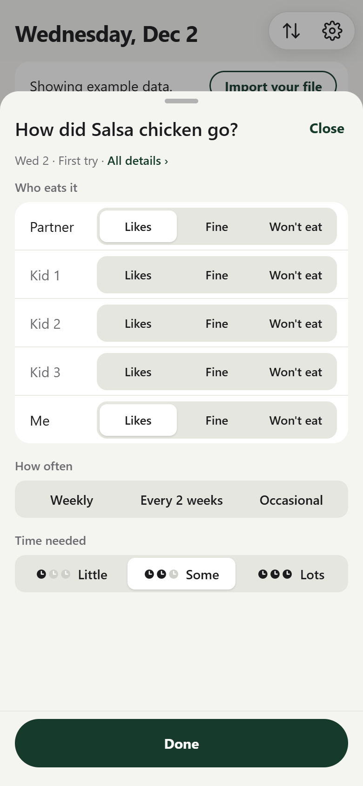

# A planning week

A walk through one week, from an empty plan to a pickup order. Screenshots use the example data.

## Home

Today's date, then **Tonight**: the one thing you most often open the app for. Below it, each week gets a card with its days. A week that still needs planning shows **Plan** (or **Continue** if you've started); a week already ordered shows its pickup day. A cart marks your shopping day; tap it to move the pickup.

When you've just tried a meal, or a meal you cooked is missing details, **Meals to rate** appears above Tonight.

## 1. Week

Three quick passes over the days:

- **Calendar** — a note per day (appointments, practice, a birthday) and the forecast.
- **Who's home** — tap someone to mark them out that night. Longer absences come from Settings › Away dates.
- **Time** — Little, Some or Lots of time to cook each night.

## 2. Meals

**Suggest all** fills every open day; **Suggest** on a day fills just that one. Each dish has ↻ to swap it and × to remove it. Tap a day's grey bar to change its note, who's home or its time without leaving the screen.

The **Week check** at the top lists what the planner noticed — someone with nothing they'll eat on a night, two similar meals back to back — so you can decide whether it matters.

**Compact** view shows one line per day, for seeing the whole week at once; swipe a day left to clear it, or drag to swap two nights.

## 3. Inventory

One tab per storage place. Checked means you're buying it. **Always buy** items start checked; anything a planned meal needs is grouped under **For this week's meals** and starts checked; weekly and slow staples start unchecked for you to look at. ⋯ on a row edits the item without leaving.

## 4. Confirm

The whole order, by meal or A–Z, with amounts. **+ Add an item** searches your items first, so a one-off joins the list with its usual amount. A planned dish with no ingredients listed is flagged at the top, so nothing gets missed.

## 5. Order

The list split into batches. **Share** sends each batch to whatever builds your cart (a shopping assistant, a notes app, a message); sent batches dim. A short cart check at the end helps catch anything the cart missed.

## Rating

After dinner (from 7pm), a meal you've just tried for the first time, or one missing details, joins **Meals to rate**. Say who liked it, how often you'd want it, and how long it took. For a meal marked New, choose **Add to rotation**, **Keep as new** or **Move to hand-picked** (only when you pick it).
